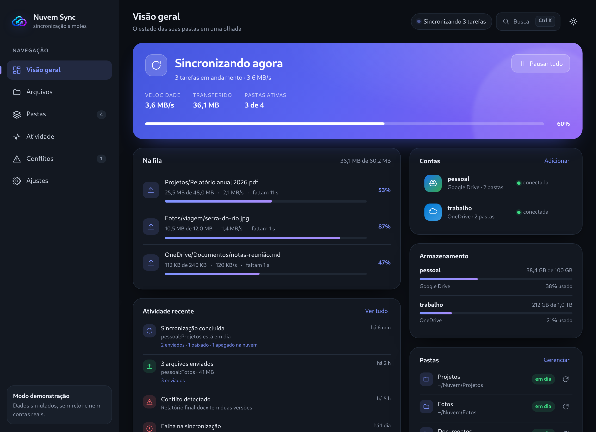

# Nuvem Sync

Two-way sync between folders on this computer and **Google Drive** or
**OneDrive** — with a careful interface you can actually use, instead of a panel
full of options. Built with [Tauri 2](https://tauri.app) (Rust + React), with
the [rclone bisync](https://rclone.org/bisync/) engine bundled inside every
package.

**English** · [Português](README.pt-BR.md)

## What it does

- **Real bisync**: changes made locally and in the cloud travel both ways on
  their own — not a one-way mirror.
- **Google Drive and OneDrive**, connected through OAuth using the app's own
  Google project (faster than the shared rclone project), with the option to use
  your own credentials instead.
- **Send and download individual files**, browse the cloud, see conflicts side by
  side and pick which version stays.
- **Safety brake**: if one side is empty and the other is not, the sync is
  blocked instead of wiping the full side.
- System tray, start with the system, native notifications, bandwidth limits,
  ignore rules, light/dark theme, and a diagnostics report that contains no
  secrets.
- **Portuguese and English**, switched in Settings → System → Language (no
  restart), with no telemetry: nothing leaves your computer except the traffic
  to Google/Microsoft.
- **Optional Pix donations** in Settings, for anyone who wants to help keep the
  project going (QR code and copy-and-paste code). No feature depends on it.

## Install

Download from [Releases](https://github.com/fabio-agreles/nuvem/releases/latest):

| Package | For |
| --- | --- |
| `Nuvem.Sync_x.y.z_amd64.deb` | Debian, Ubuntu, Mint — `sudo apt install ./*.deb` |
| `Nuvem.Sync_x.y.z_amd64.AppImage` | Any Linux, no install (uses the system WebKitGTK) |
| `Nuvem-Sync-x.y.z-x86_64.flatpak` | Flatpak, sandboxed |
| `Nuvem.Sync_x.y.z_x64-setup.exe` | Windows 10/11 (NSIS installer, not code-signed) |
| `Nuvem-Sync-x.y.z-windows-x64.zip` | Windows 10/11 portable, no install |

The space in the app name became a dot in the file names (`Nuvem.Sync_…`)
because the Tauri bundler replaces spaces with dots; inside the package the name
is `nuvem-sync` (Debian) and the binary is still `/usr/bin/nuvem`.

> Since 1.3.0 the app is called **Nuvem Sync** and the Debian package was renamed
> (`nuvem` → `nuvem-sync`). The new `.deb` declares `Conflicts`/`Replaces` for
> the old one, so `sudo apt install ./*.deb` replaces the previous version — you
> don't end up with two apps installed or a conflict in `/usr/bin/nuvem`.

rclone ships inside every package: you don't need to install it.

## Documentation

The in-depth docs are written in Portuguese:

- [`app/README.md`](app/README.md) — architecture, running from source, speed
  decisions and known limits.
- [`docs/roteiro-teste-windows.md`](docs/roteiro-teste-windows.md) — Windows test
  walkthrough.
- [`docs/oauth-google.md`](docs/oauth-google.md) — your own Google OAuth project
  (and why it matters for the quota).
- [`docs/flathub-pr.md`](docs/flathub-pr.md) — Flathub submission.
- [`docs/doacoes.md`](docs/doacoes.md) — Pix donations: how the QR code is
  generated and how to change the key.
- [`docs/idiomas.md`](docs/idiomas.md) — how the language switch works and what
  to do when a UI string changes.
- [`PRIVACIDADE.md`](PRIVACIDADE.md) — privacy policy (English summary at the
  end).
- [`PLANO.md`](PLANO.md) — what is done and what is left.

## Status

Runs on Linux (Flatpak, `.deb`, AppImage) and Windows. Known limitations: the
packages are not code-signed (SmartScreen warns on Windows), the AppImage does
not bundle WebKitGTK, and the Google OAuth project is still going through
verification — which caps how many new accounts can authorize the app for now.

License: [MIT](LICENSE).
