# Nuvem

Aplicativo desktop de sincronização (Google Drive + OneDrive) com foco em clareza
visual e poucos cliques. Fases 1, 2 e 3 implementadas: contas, pastas, bisync real
(nos dois sentidos), sincronização automática (inotify + intervalo), fila ao vivo,
atividade com histórico por arquivo, resolução de conflitos, quota por conta,
notificações, ajustes, nova tentativa automática, upload/download avulsos,
tamanho por pasta e início automático (`org.freedesktop.portal.Background`). Sincronização real com Google Drive verificada de ponta a ponta. Empacotado como **Flatpak** (GNOME 50), **`.deb`**, **AppImage** e **`.exe` x64 do
Windows**, todos com
o rclone embutido.

## Status

| Área | Estado |
| --- | --- |
| UI (6 telas, tema claro/escuro, Ctrl+K, atalhos 1–6) | ✅ |
| Motor de sync com rclone (`sync/bisync`, jobs assíncronos) | ✅ |
| Contas Google Drive/OneDrive via OAuth do rclone | ✅ (depende do navegador) |
| Progresso ao vivo, pausar/retomar, sincronizar agora | ✅ |
| Pastas (criar, ativar, remover, ressincronizar) | ✅ |
| Navegação da nuvem (somente leitura) | ✅ |
| Atividade persistida | ✅ |
| Conflitos: detectar, comparar e resolver (nuvem/local/ambas) | ✅ |
| Limites de banda e regras de ignorar | ✅ (aplicados na próxima execução) |
| Bandeja com status, fechar para a bandeja | ✅ |
| Ícone simbólico na bandeja (preto no tema claro, branco no escuro) | ✅ |
| Layout que se reorganiza em janelas estreitas (elipse, cartões empilhados, painel icônico) | ✅ |
| Limpar o histórico de atividade (com confirmação) | ✅ |
| Iniciar com o sistema (Flatpak pelo portal `org.freedesktop.portal.Background`) | ✅ |
| Quota real por conta (`operations/about`), com último valor guardado | ✅ |
| Trava do bisync de execução interrompida removida sozinha | ✅ |
| Notificações nativas ao concluir/falhar | ✅ |
| Sincronização automática: reação a mudanças locais (`inotify`) | ✅ |
| Verificação periódica da nuvem (1/5/15/30/60 min, ajustável) | ✅ |
| Nova tentativa automática em falhas de rede (15 s / 60 s / 180 s) | ✅ |
| Enviar e baixar arquivos avulsos na aba Arquivos | ✅ |
| Tamanho e contagem de itens da pasta aberta (`operations/size`) | ✅ |
| Flatpak (GNOME 50, rclone + bandeja embutidos, build **offline** com crates/npm/Go vendorizados) | ✅ construído e instalado localmente |
| Pacotes `.deb` e AppImage com rclone embutido | ✅ gerados e testados |
| Versão Windows (`Nuvem.exe` x64 + `rclone.exe`), compilada a partir do Linux | ✅ pacote portátil gerado; instalação e teste em máquina Windows pendentes |
| Sincronização real (Google Drive, duas vias) | ✅ verificada: 1 pasta, ida e volta |
| Histórico por arquivo (lido do log do bisync, por execução) | ✅ |
| App de instância única (dois cliques não abrem dois motores) | ✅ |
| Desconectar conta (apaga as credenciais do rclone e o cache do bisync) | ✅ |
| OneDrive: escolha do drive concluída automaticamente ao conectar | ✅ |
| Adicionar pasta escolhendo na lista de pastas da nuvem | ✅ |
| Aba Arquivos mantém a conta e o caminho ao trocar de aba | ✅ |
| Transferências ajustadas para o limite do Google (3× mais rápido no teste) | ✅ |
| Credenciais OAuth próprias do Google em **Ajustes → Avançado** | ✅ |
| Painel RC do rclone com senha sorteada a cada execução (HTTP Basic) | ✅ |
| Estado gravado com `0600` e recuperação automática de arquivo corrompido | ✅ |
| Licença MIT (`LICENSE`) e repositório git versionado | ✅ |
| Build Flatpak offline com crates, npm e módulos Go vendorizados | ✅ |
| Metainfo AppStream completo (`developer`, URLs, 6 capturas 2x, `releases`) e `.desktop` sem avisos | ✅ |

## Prévia

Capturas do modo demonstração (`npm run dev`), com dados simulados — as do
metainfo do Flatpak são as mesmas, em 2480×1800:

| | |
| --- | --- |
| 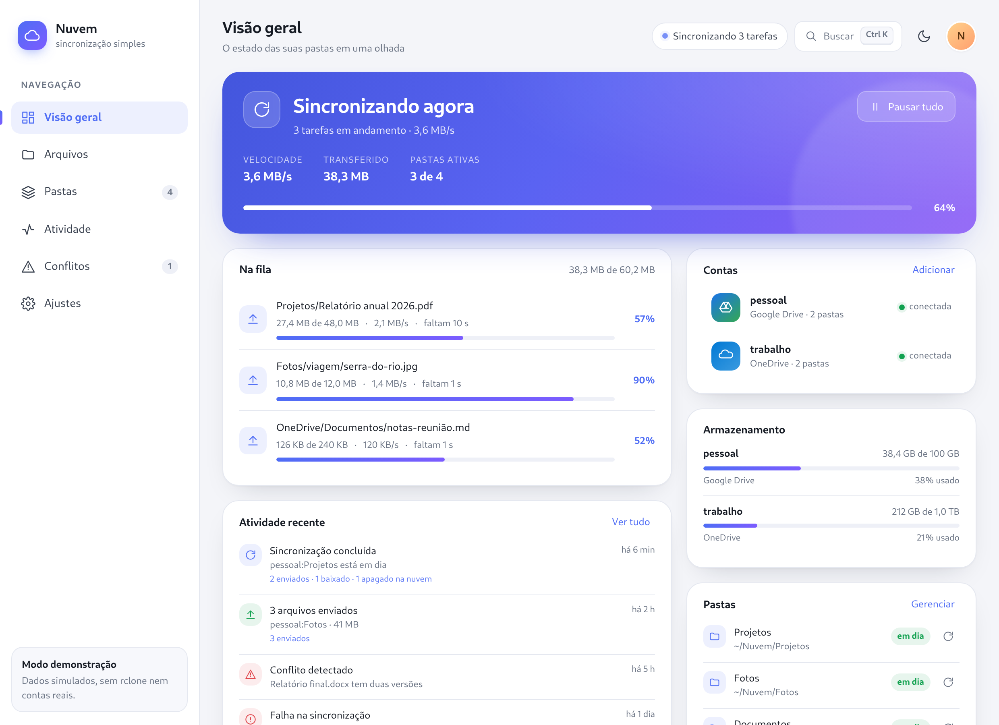 | 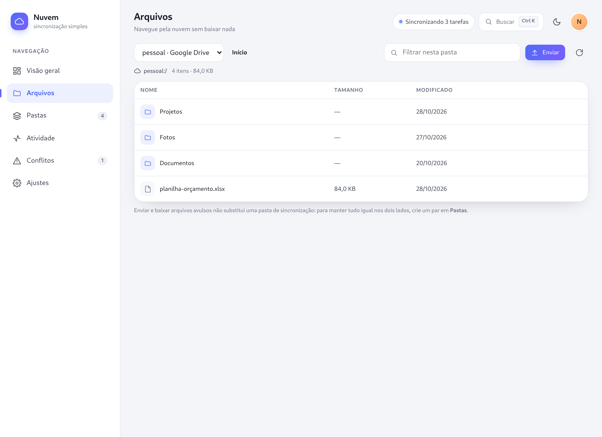 |
| 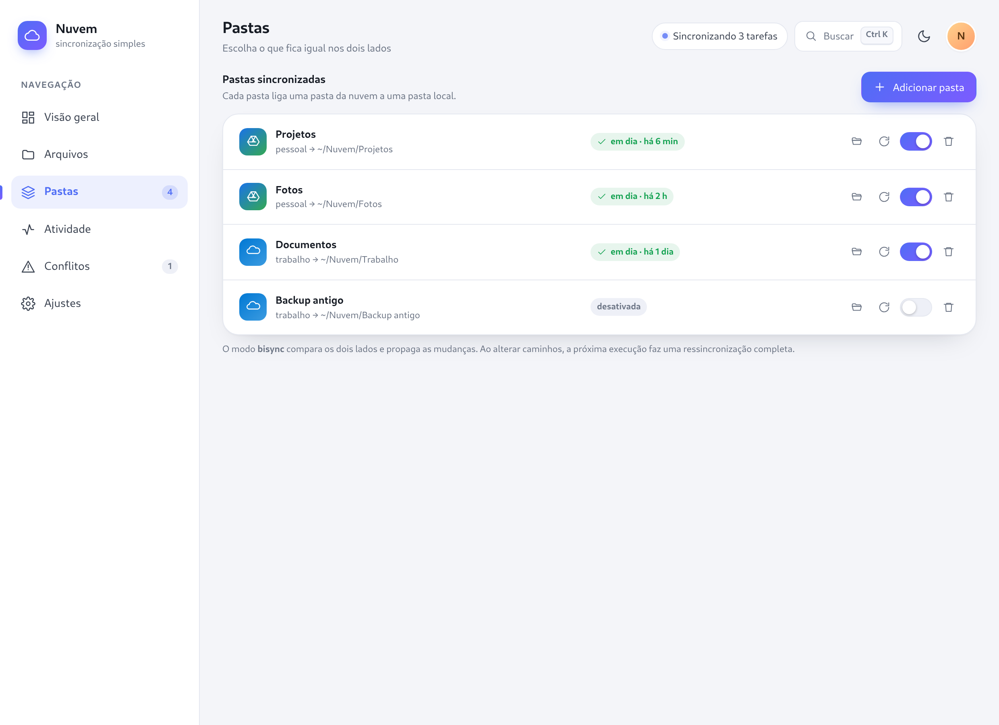 | 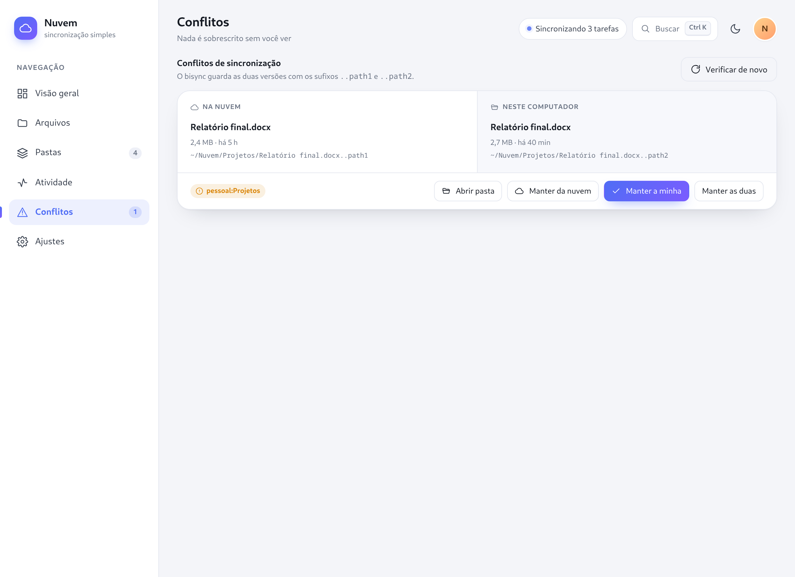 |
| 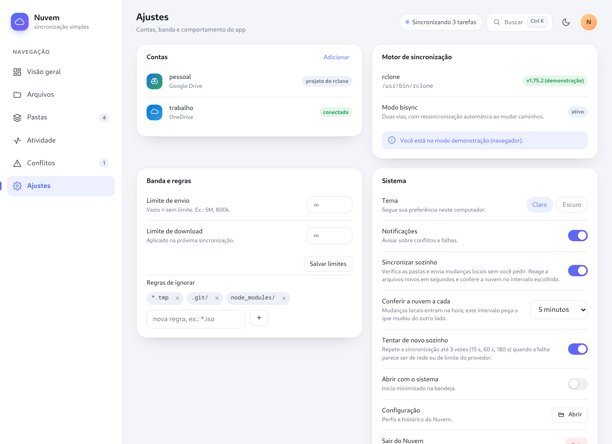 | 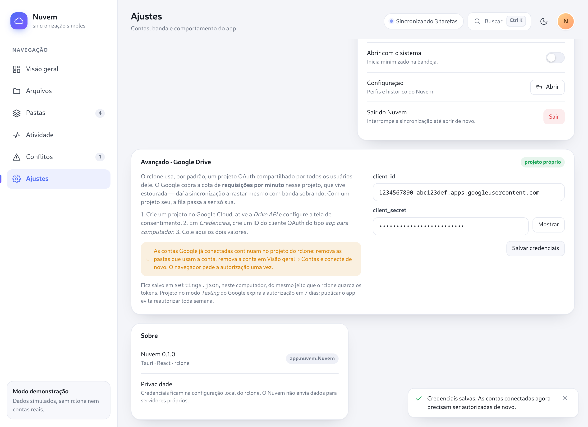 |
| 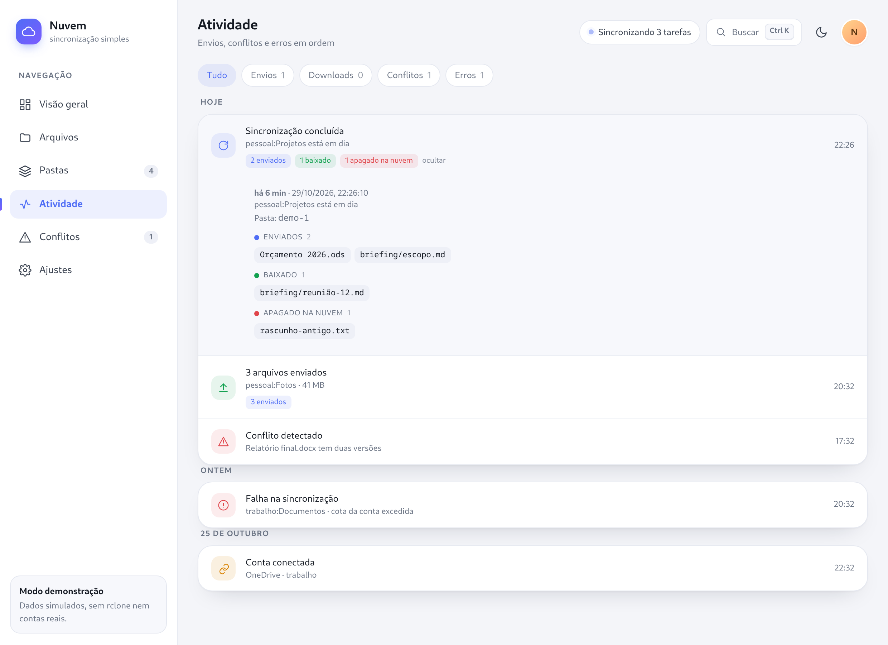 | 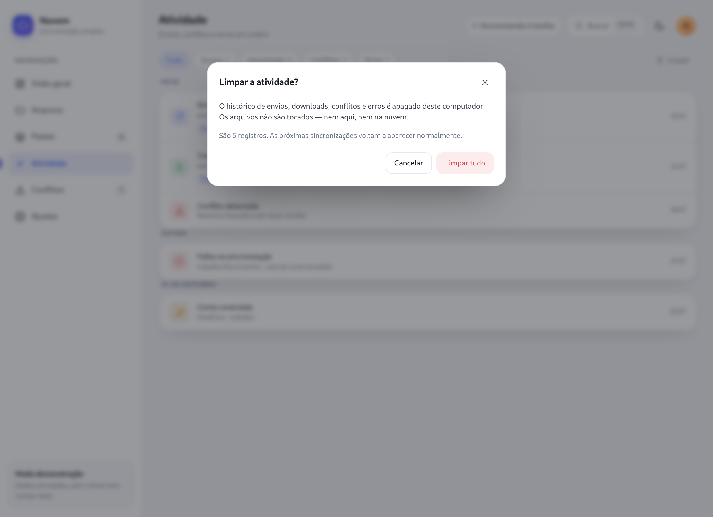 |
| 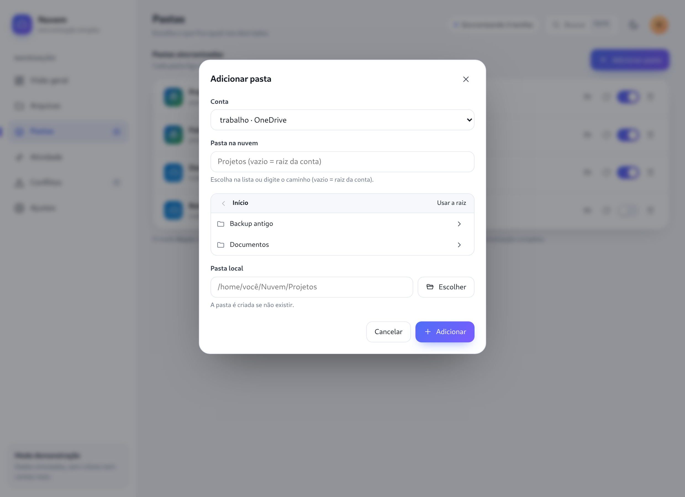 | 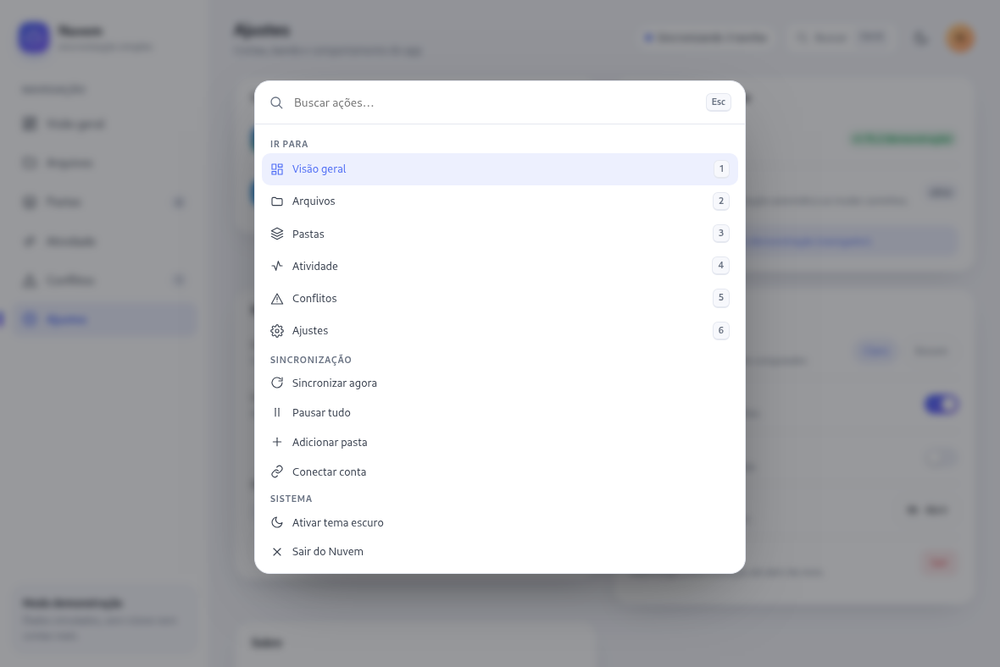 |
| 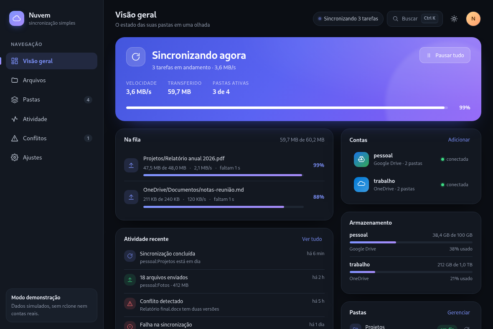 | 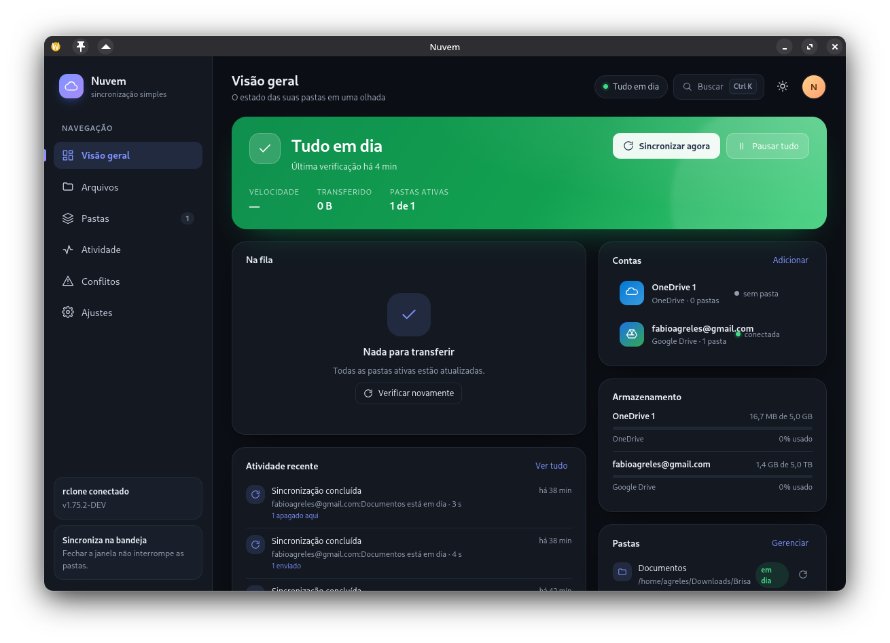 |

Para refazer o conjunto (o script esconde o selo *Modo demonstração* e usa
1240×900 @2x):

```bash
npm run build && npx vite preview --port 4173 &
NODE_PATH=/caminho/do/node_modules node scripts/capture-previews.mjs
```

`playwright-core` não é dependência do app: aponte `NODE_PATH` (ou
`PLAYWRIGHT_CORE=`) para onde ele estiver instalado.

## Rodar

Pré-requisitos para **desenvolver** no Linux: Node 22+, Rust 1.90+, `webkit2gtk-4.1`,
`libappindicator3` e **rclone 1.75+** no `PATH` (ou `NUVEM_RCLONE=/caminho/rclone`).
Os pacotes prontos (`.deb`, AppImage, Flatpak e o `.exe` do Windows) já trazem o
rclone embutido.

Para **rodar** o AppImage numa máquina Linux, o sistema precisa do WebKitGTK 4.1
(`libwebkit2gtk-4.1-0` no Debian/Ubuntu, `webkit2gtk-4.1` no Fedora/Arch) e do
GTK 3 — o AppImage não empacota o WebKit, porque ele conversa com o compositor da
sessão. No Windows, o equivalente é o WebView2 (já vem no Windows 11).

```bash
cd nuvem/app

npm install

# 1) ver a interface sem rclone (dados simulados, abre no navegador)
npm run dev            # http://localhost:1420

# 2) rodar o app desktop de verdade
npm run tauri:dev

# 3) baixar o rclone que vai embutido (~82 MB; não fica no repositório)
scripts/fetch-rclone.sh            # ou: scripts/fetch-rclone.sh 1.75.2 linux

# 4) empacotar (.deb e AppImage)
npm run tauri:build
```

O modo navegador usa um backend de demonstração (`src/lib/demo.ts`); o app desktop
usa o backend Rust (`src-tauri/`). A UI escolhe automaticamente.

## Pacotes gerados

| Pacote | Arquivo | Tamanho | rclone |
| --- | --- | --- | --- |
| `.deb` | `src-tauri/target/release/bundle/deb/Nuvem_0.1.0_amd64.deb` | 31,1 MB | embutido em `/usr/lib/Nuvem/rclone` |
| AppImage | `src-tauri/target/release/bundle/appimage/Nuvem_0.1.0_amd64.AppImage` | 124,7 MB | embutido em `usr/lib/Nuvem/rclone` |
| Flatpak | repositório local em `flatpak-repo/` | 91,5 MB instalado | compilado em `/app/bin/rclone` |
| Windows (portátil) | `src-tauri/target/x86_64-pc-windows-msvc/release/bundle/windows-portatil/Nuvem-0.1.0-windows-x64.zip` | 30 MB | `rclone.exe` ao lado do `Nuvem.exe` |

A busca do motor (`Rclone::find_binary`) tenta, em ordem: `NUVEM_RCLONE`, a cópia
ao lado do executável (`rclone` ou `rclone.exe`, conforme o sistema) e em
`resources/`, `lib/Nuvem/rclone` e `lib/nuvem/rclone` (pacotes), `PATH`,
`/app/bin`, `/usr/bin`, `/usr/local/bin` e `~/.local/bin`. No Windows ainda
aparecem `%LOCALAPPDATA%\Nuvem` e `%LOCALAPPDATA%\Programs\Nuvem`. Por isso o
`.deb`, o AppImage e o `.exe` funcionam numa máquina sem rclone instalado.

```bash
# gerar os dois pacotes de uma vez (o rclone precisa estar em resources/)
scripts/fetch-rclone.sh
npm run tauri:build      # ou: npx tauri build --bundles deb appimage
```

### Metadados do `.deb`

O bundler do Tauri mescla as dependências que ele detecta com as declaradas e
insere `libappindicator3-1` como dependência dura. Isso **quebra a instalação em
distros novas** (Ubuntu 24.04+ não tem esse pacote; a biblioteca é carregada por
`dlopen`). Por isso `scripts/fix-deb.sh` reescreve o `control`:

```
Depends: libwebkit2gtk-4.1-0, libgtk-3-0
Recommends: libayatana-appindicator3-1
```

O script roda automaticamente no fim de `npm run tauri:build` (`npm run deb:fix`
aplica só a correção, sem reconstruir).

Instalar o pacote:

```bash
sudo dpkg -i src-tauri/target/release/bundle/deb/Nuvem_0.1.0_amd64.deb
# se faltar alguma dependência:
sudo apt -f install
```

Flatpak: veja [`flatpak/README.md`](flatpak/README.md).

## Windows

A versão do Windows é compilada **a partir do Linux**, com `cargo-xwin` e o alvo
`x86_64-pc-windows-msvc`. O resultado é um PE de verdade (GUI, x64), sem precisar
de uma máquina Windows na hora do build:

```bash
rustup target add x86_64-pc-windows-msvc
cargo install cargo-xwin          # uma vez

# llvm-rc/llvm-lib no PATH: pacote `llvm` da distro ou a toolchain llvm-mingw
# (https://github.com/mstorsjo/llvm-mingw/releases)

scripts/build-windows.sh          # baixa o rclone.exe se faltar e monta o .zip
```

Sai em `src-tauri/target/x86_64-pc-windows-msvc/release/bundle/windows-portatil/`:
um `.zip` com `Nuvem.exe`, `rclone.exe` (o app procura o motor ao lado do
executável) e um `LEIA-ME.txt` com requisitos, caminhos de dados e como ligar o
início automático.

O que muda no código por causa do Windows:

- **`rclone.exe`**: o nome do binário tem sufixo (`RCLONE` em `rclone.rs`), e a
  busca ganha `%LOCALAPPDATA%\Nuvem` e `%LOCALAPPDATA%\Programs\Nuvem`.
- **`CREATE_NO_WINDOW`** ao subir o daemon: sem isso, cada sincronização abriria
  uma janela de console preta piscando.
- **Abrir pasta**: `explorer` no lugar de `xdg-open`.
- **Início automático**: o módulo do Flatpak fala D-Bus com o portal; fora do
  Unix entra `autostart_outro.rs` e quem grava é o plugin do Tauri, na chave
  `Run` do registro (`HKCU\Software\Microsoft\Windows\CurrentVersion\Run`).
- **`zbus`** virou dependência só de Unix no `Cargo.toml` — era a única peça do
  projeto que não existe no Windows.
- **`tauri.windows.conf.json`** guarda o que é do pacote: alvo `nsis`, recurso
  `rclone.exe`, `webviewInstallMode: embedBootstrapper` (instala o WebView2 se
  faltar), instalação por usuário e idiomas pt-BR/en.

**O instalador NSIS não sai do Linux**: o bundler chama `makensis.exe`. Até rodar
num Windows — ou no workflow `.github/workflows/pacotes.yml`, que monta `.deb`,
AppImage e o `-setup.exe` —, o que existe é o pacote portátil.

O `.exe` não é assinado: na primeira execução o SmartScreen mostra “O Windows
protegeu o computador” e esconde o botão *Executar* atrás de *Mais informações*.
É o esperado para binário sem certificado; distribuir em escala pede um
certificado (EV ou Azure Trusted Signing).

## Instalar como Flatpak

Já construído neste ambiente (runtime GNOME 50, rclone e bibliotecas de bandeja
dentro do sandbox). Para reinstalar a partir do repositório local gerado:

```bash
flatpak install --user --reinstall -y \
  /home/agreles/Aplicativos/Goose/nuvem/flatpak-repo app.nuvem.Nuvem
flatpak run app.nuvem.Nuvem
```

O build é **offline**: crates (`cargo-sources.json`), pacotes npm
(`node-sources.json`) e módulos Go do rclone (`rclone-sources.json` +
`modules.txt`) viajam como fontes no manifesto, e as etapas rodam com
`cargo --offline`, `npm ci --offline` e `go build -mod=vendor` — é o que o Flathub
exige. Para construir do zero, regenerar os arquivos vendorizados e ver as
pendências (`$HOME` apenas, `aarch64`, metainfo), veja
[`flatpak/README.md`](flatpak/README.md).

## Como usar

1. **Conectar conta** → escolha Google Drive ou OneDrive. O rclone abre o navegador;
   conclua a autorização. Nomeie a conta como quiser.
2. **Adicionar pasta** → escolha a conta, navegue pelas pastas da nuvem na lista
   (dá para digitar o caminho também; vazio = raiz) e a pasta local. O app cria a
   pasta local e inicia um `bisync` com `--resync`.
3. Daí em diante é automático: mudanças na pasta local sobem em segundos (o app
   observa os arquivos) e a nuvem é conferida no intervalo escolhido em **Ajustes**
   (1, 5, 15, 30 ou 60 minutos). Verificações sem novidade não ocupam a atividade.
4. Acompanhe em **Visão geral** (fila, velocidade, ETA) e **Atividade**.
5. Ao mudar conta ou caminhos de uma pasta, a próxima execução ressincroniza
   automaticamente.
6. Em **Ajustes → Abrir com o sistema**, o Nuvem passa a iniciar minimizado na
   bandeja junto com a sessão. Dentro do Flatpak quem escreve o item de
   inicialização é o sistema (portal), não o app.
7. Para desconectar uma conta: **Visão geral → Contas**, passe o mouse na conta e
   use a lixeira. Se ainda houver pasta usando a conta, o Nuvem pede para removê-la
   antes (e leva você para **Pastas**). Nada é apagado na nuvem nem no disco.
8. **Limpar a atividade**: em **Atividade**, o botão *Limpar* (à direita dos filtros)
   pede confirmação e apaga o histórico deste computador — os arquivos não são
   tocados. A limpeza vale também depois de fechar o app.

## Arquitetura

```
React + TypeScript (src/)
  ↕ invoke/listen (Tauri IPC)
Rust (src-tauri/src/)
  ├─ commands.rs   contas, perfis, sync, conflitos, ajustes
  ├─ monitor.rs    observa jobs e grava atividade
  ├─ rclone.rs     sobe/gerencia `rclone rcd` em porta loopback
  └─ state.rs      perfis, atividade e ajustes em JSON
  ↕ HTTP JSON local (127.0.0.1)
rclone 1.75 (rcd)  → sync/bisync, operations/list, core/stats, job/*
```

Cada pasta é um par `conta:caminho ←→ pasta local`. O app usa `sync/bisync` com
`_async: true`, guarda o `jobid` devolvido e acompanha cada tarefa com `job/status`
(e `core/stats` só enquanto há tarefa rodando).

## Onde ficam os dados

- Perfis, atividade e ajustes: `~/.config/app.nuvem.Nuvem/`.
- Cópias descartadas ao resolver conflitos: `~/.config/app.nuvem.Nuvem/conflitos-resolvidos/`.
- Credenciais das contas: configuração padrão do rclone (`~/.config/rclone/rclone.conf`).
- Nenhum dado vai para servidores do Nuvem.

## Segurança e limites conscientes

- O daemon `rclone rcd` escuta apenas em `127.0.0.1`, em porta aleatória, e **exige
  HTTP Basic**: a cada execução o app sorteia usuário e senha novos
  (`--rc-user`/`--rc-pass`, 24 bytes do gerador do sistema) e guarda só na memória.
  Antes disso o painel subia com `--rc-no-auth`, e em máquina multiusuário um
  `curl` de outro usuário conseguia ler os tokens via `config/dump`.
- Os arquivos de estado (`settings.json`, `profiles.json`, `activity.json`) são
  gravados com permissão `0600`, porque `settings.json` pode conter o
  `client_secret` do Google. A gravação é atômica (`.tmp` + `rename`) e a versão
  anterior fica como `.bak`: se um arquivo aparecer ilegível, o app recupera o
  backup, guarda a cópia quebrada como `.corrompido` e avisa na atividade — em vez
  de abrir “vazio” e apagar o resto na gravação seguinte.
- O daemon é filho do app e é encerrado na saída; perfis e jobs são descartados.
- Fechar a janela **não** encerra o app: ele continua na bandeja. Use **Sair** nos
  ajustes ou o menu da bandeja.
- O bisync altera arquivos nos dois lados por definição. Use uma pasta descartável
  no primeiro teste.

## Cota por conta

O cartão **Armazenamento** lê `operations/about` de cada conta a cada 30 s. Quando
a leitura falha (o Google responde 403 de cota em rajada; o OneDrive some por alguns
segundos ao renovar o token), o app **repete uma vez** — subindo o daemon de novo se
for o caso — e, se ainda falhar, mantém na tela **o último valor lido**, com o selo
*desatualizada* e o motivo no tooltip. Só quando nunca houve leitura aparece
“não consegui ler agora”, com um link *tentar de novo*.

## Velocidade no Google Drive

O daemon sobe com um ajuste pensado no limite do Google (em `rclone.rs`):

| Opção | Valor | Por quê |
| --- | --- | --- |
| `--tpslimit` / `--tpslimit-burst` | 10 / 20 | o Google limita **requisições por minuto** no projeto OAuth compartilhado do rclone; sem teto, o rclone leva 403 em cascata e o *pacer* passa a dormir 8 s, 16 s por tentativa |
| `--drive-upload-cutoff` | 16M | arquivos até 16 MiB sobem em **uma** requisição |
| `--drive-chunk-size` | 32M | um arquivo de 100 MiB vira 4 pedidos em vez de ~13 |
| `--transfers` / `--checkers` | 6 / 8 | mais arquivos em paralelo sem multiplicar os 403 |

Medido neste ambiente (link de ~10 MB/s de subida, mesma conta e mesmos arquivos,
antes → depois):

| Carga | Antes (padrões do rclone) | Depois |
| --- | --- | --- |
| 1 arquivo de 64 MiB | 121 s (uma vez) / 27 s | **9 s** (~7,5 MB/s) |
| 100 arquivos de 200 KiB | 349 s | **242 s** |

O teto real não é a banda: é a cota do projeto OAuth que o rclone usa por padrão.
O próprio rclone avisa que esse `client_id` compartilhado **vai parar de funcionar
durante 2026**.

Por isso o app aceita **credenciais próprias** em **Ajustes → Avançado · Google
Drive**: cole o `client_id` e o `client_secret` de um projeto seu
([passo a passo](https://rclone.org/drive/#making-your-own-client-id)) e as contas
conectadas a partir dali autorizam contra ele — a cota de requisições passa a ser só
sua. O cartão mostra o estado de cada conta (*projeto do rclone* / *cota própria*) e
avisa que contas antigas precisam ser removidas e conectadas de novo (o token vale
para o projeto que o emitiu).

Ressalva do Google: projeto no modo *Testing* expira a autorização em **7 dias**;
publicar o app (verificação do escopo `drive`) evita reautorizar toda semana.

## Limitações atuais

- O histórico por arquivo vem do log do bisync: diz **o que** mudou (enviado,
  baixado, apagado de um dos lados), sem tamanho por arquivo. Fica guardado nas
  últimas 200 sincronizações.
- Envio/baixar avulso é um a um: não há arrastar-e-soltar nem fila própria para
  muitos arquivos; para volume, use uma pasta de sincronização.
- A nova tentativa automática cobre falhas de rede/limite do provedor; erros de
  configuração (token revogado, pasta sem permissão) aparecem na hora, sem repetir.
- A bandeja mostra o estado no tooltip, não uma barra de progresso. O ícone é
  simbólico: traço preto no tema claro, branco no escuro, trocado na hora.
- Resolver um conflito não dispara uma nova sincronização automaticamente; a próxima
  execução propaga o resultado.
- No Flatpak, a sincronização fica restrita ao `$HOME` (`--filesystem=home`).

## Validação executada

- `npx tsc --noEmit` — sem erros.
- `npm run build` (tsc + Vite) — OK, bundle 300 kB (89 kB gzip).
- `cargo build` (Tauri debug) — OK, binário em `src-tauri/target/debug/nuvem`.
- UI renderizada em navegador headless (modo demonstração) sem erros de layout.
- `cargo build` com os plugins de notificação e diálogo — OK.
- Build Flatpak completo (`org.flatpak.Builder`, GNOME 50) — OK, exportado e
  instalado em `--user`; app abre, `rclone v1.75.2` responde em `core/version`
  dentro do sandbox e a bandeja registra no `StatusNotifierWatcher`.
- **Build Flatpak vendorizado (offline)**: crates, npm e módulos Go como fontes;
  nenhuma etapa com `--share=network`. Commit `ed74456` (90,7 MB de conteúdo)
  instalado e executado: interface real (contas e pastas do usuário), `rclone` de
  84 MB compilado do fonte e painel RC respondendo `401` sem credencial e `200`
  com HTTP Basic.
- `npx tauri build` — OK: `.deb` (31,1 MB) e AppImage (124,7 MB) com rclone embutido.
  Verificado extraindo o `.deb` e o AppDir do AppImage e rodando com `PATH` sem
  rclone: em ambos o app chamou o binário embutido (`version`, `config dump`).
  `scripts/fix-deb.sh` deixa o `Depends` sem `libappindicator3-1` (instalável em
  Ubuntu 24.04+).
- **AppImage executado nesta máquina**: o processo do app sobe, o WebKit cria os
  processos `WebKitNetworkProcess`/`WebKitWebProcess` e o `rclone` embutido em
  `usr/lib/Nuvem/rclone` é o que responde ao daemon. Sem FUSE? O runtime 2 aceita
  `APPIMAGE_EXTRACT_AND_RUN=1` e roda igual.
- **Windows (compilado no Linux)**: `scripts/build-windows.sh` com
  `cargo-xwin` + `x86_64-pc-windows-msvc` produziu um `PE32+ GUI x86-64` de 4,7 MB
  e o `.zip` portátil de 30 MB com `rclone.exe`. O binário contém o código novo
  (`client_id`, `set_tray_theme`, `rclone.exe`). O bundler para antes do NSIS
  (`makensis.exe` é do Windows) — daí o workflow de CI.
  **Não executado**: rodar o `.exe` numa máquina Windows (bandeja, WebView2 e a
  chave `Run` do registro só se confirmam lá).
- **Sincronização automática**, medida com `syncIntervalMin` em 1 minuto:
  - arquivo criado na pasta local subiu para o Drive em ~4 s, sem nenhum clique;
  - arquivo criado no Drive desceu em ~30 s (verificação periódica);
  - verificação sem mudanças não gera atividade nem notificação, mas atualiza
    “última verificação” (contagem de atividades ficou igual por 80 s).
- **Sincronização real com Google Drive** (`fabioagreles@gmail.com`, `Documentos` ↔
  `~/Downloads/Brisa`), feita com a conta do usuário:
  - ressincronização inicial concluída em 3 s e `resyncNeeded` virou `false`;
  - arquivo criado na pasta local subiu para a nuvem;
  - arquivo criado na nuvem desceu para a pasta local;
  - exclusão nos dois lados foi bloqueada pela proteção do rclone
    (*too many deletes*), com mensagem traduzida na atividade, `resyncNeeded`
    ligado automaticamente e a sincronização seguinte aplicando a exclusão;
  - exclusão propagada nos dois sentidos depois da correção do `maxDelete`;
  - refazer a mesma verificação dentro do **Flatpak** instalado: arquivo local subiu
    em 4 s e a interface passou a “Tudo em dia · agora” sozinha.
- **Início automático**, exercitado com o código real dentro do Flatpak: ligar
  criou `~/.config/autostart/app.nuvem.Nuvem.desktop` com
  `Exec=flatpak run --command=/app/bin/nuvem app.nuvem.Nuvem --minimized`,
  `X-Flatpak=app.nuvem.Nuvem` e `Icon=app.nuvem.Nuvem`; desligar apagou o arquivo;
  `kreadconfig6` lê o `Exec` de volta. A linha de comando foi aberta com
  `--minimized` e a janela **não** apareceu (só a bandeja).
- **Histórico por arquivo**, no Flatpak com a conta real:
  - `historico-dois.txt` criado na pasta local → atividade com
    `historico-dois.txt · enviado`;
  - o mesmo arquivo apagado localmente → `historico-dois.txt · apagado aqui`
    (a exclusão foi propagada e a pasta ficou em dia);
  - `historico-nuvem.txt` criado direto no Drive → `historico-nuvem.txt ·
    baixado`, e o arquivo apareceu na pasta local.
- **Instância única**: `flatpak run app.nuvem.Nuvem` com o app aberto não cria um
  segundo processo (continua 1 no `flatpak ps`) e a janela existente vem à frente.
- **Escolha de pasta e de conta** (modo demonstração, navegador headless): trocar
  para a segunda conta em Arquivos, ir para Pastas e voltar manteve a conta
  escolhida (`trabalho`); o modal de adicionar pasta listou as pastas da conta,
  permitiu entrar em uma delas pelo chevron e selecioná-la pelo nome.
- **OneDrive**, reparo da conta conectada pela metade (sem `drive_id`), exercitado
  com o código real: a máquina de estados do `config/update` foi percorrida
  (mantendo o token, escolhendo “onedrive”, escolhendo o drive *OneDrive* em vez do
  `ODCMetadataArchive` e confirmando), e a listagem passou a devolver `Anexos`,
  `Documentos`, `Imagens`… Também verificado no app instalado.
- **Remoção de conta**, exercitada com o código real (uma conta de teste `local`):
  com pasta vinculada, a resposta foi *“remova antes a pasta ‘Documentos’ — ela
  ainda usa esta conta”* e o remote ficou intacto; sem pasta, o remote saiu do
  `rclone config` (`listremotes` vazio).
- **Janela estreita** (navegador headless, modo demonstração): em 1177, 1024, 880,
  740 e 600 px de largura não há rolagem horizontal (`scrollWidth` = `clientWidth`)
  nem sobreposição. Em 1177 px o dashboard continua em duas colunas (520 + 335 px,
  com os textos truncados por elipse); abaixo de 1120 px empilha, o painel lateral
  vira ícone em ≤900 px e o *hero* joga os botões para a linha de baixo em ≤820 px.
- **Cota com falha passageira**: `ler_cota` tenta duas vezes (subindo o daemon de
  novo entre elas) e, persistindo o erro, devolve o último valor com
  `stale: true`; os cartões mostram o número com o selo *desatualizada* em vez de
  “cota indisponível”.
- **Limpar a atividade**, no app instalado: o botão *Limpar* aparece ao lado dos
  filtros, o modal confirma (“São N registros”), e o `activity.json` fica `[]` —
  verificado também no teste `limpar_atividade_apaga_memoria_e_arquivo`.
- **Ícone simbólico da bandeja**, no app instalado: painel escuro mostrou a nuvem
  em traço branco (64×64, sem nenhum pixel colorido) e o arquivo entregue ao painel
  é `~/.var/app/app.nuvem.Nuvem/cache/nuvem/bandeja/tray-icon-main-0.png` — fora do
  tmpfs privado do sandbox, que é o que impedia o painel de ler o ícone.
- **Velocidade do Google Drive**, medida com o rclone do Flatpak contra a conta
  real: 64 MiB em 27 s → **9 s**; 100 arquivos de 200 KiB em 349 s → 242 s (tabela
  acima). Os 403 de cota (`Queries per minute`, projeto
  `202264815644`) desapareceram do log na maior parte das execuções depois do
  `--tpslimit 10`.
- **Trava do bisync depois de fechar o app no meio de uma sincronização**:
  `prior lock file found` deixava a pasta em erro para sempre. O app agora remove
  `.lck` com mais de um minuto quando não tem tarefa rodando (na prática: no
  primeiro sync depois de abrir) e registra “Trava antiga do bisync removida”.
- `cargo test` — **35 testes** (retry + limpeza de log do rclone + detecção de
  ressincronização + histórico por arquivo + leitura do `.desktop` de autostart +
  limpeza de atividade + ícones da bandeja + travas do bisync + validação do par
  `client_id`/`client_secret` + credenciais do painel RC + recuperação de JSON
  corrompido + permissões do `settings.json`) passando.
- **Painel RC autenticado, testado contra o rclone de verdade**: com
  `--rc-user`/`--rc-pass` sorteados, `POST /core/version` sem credencial devolve
  **401** e com credencial devolve a versão (teste `daemon_sobe_autenticado`, que
  sobe o daemon e o derruba no fim). O cliente do app manda `Authorization: Basic`
  (teste `chamada_leva_autenticacao_basica`, contra um servidor TCP de mentira).
- **Arquivo de estado ilegível**: `settings.json` truncado (como uma queda no meio
  da gravação deixaria) é recuperado do `.bak`, a cópia quebrada vai para
  `.corrompido` e a atividade mostra o aviso — testes `json_corrompido_usa_backup_e_avisa`
  e `json_corrompido_sem_backup_avisa_que_perdeu`.
- **Não executado**: instalação do `.deb` via `dpkg` (sem `sudo`/`dpkg-deb` aqui).
- **Não executado**: o fluxo de credenciais próprias até o fim (autorizar no
  navegador e sincronizar com um `client_id` seu). O par é validado por teste
  (`credenciais_do_drive_precisam_vir_em_par`,
  `client_id_com_formato_errado_e_recusado`), o cartão está no binário do Flatpak e
  o `connect_account` passa os valores como `parameters` do `config/create`; falta
  apenas criar o projeto no Google Cloud para ver a cota trocar de dono.

## Armadilhas já resolvidas (para não voltar nelas)

- **`cargo build --release` sem `--features custom-protocol`** gera um binário que
  carrega a `devUrl` e mostra *“Could not connect to localhost”*. Use `tauri build`
  ou passe a feature (é o que o manifesto Flatpak faz). O sintoma engana: a bandeja
  funciona, o rclone responde, só a interface não aparece.
- **`Operation not permitted` ao limpar `.flatpak-builder`**: o cache de módulos Go
  nasce sem permissão de escrita. Use `chmod -R u+w` antes do `rm -rf` (ou
  `GOFLAGS=-modcacherw`; o build vendorizado não cria esse cache).
- **JSON de fontes como objeto no manifesto Flatpak**: `{"type": "file", "path":
  "cargo-sources.json"}` só **copia** o arquivo para o build — as fontes de dentro
  dele nunca são aplicadas e o `cargo` sai tentando o crates.io. O correto é o nome
  do JSON como **string** na lista `sources` (`"cargo-sources.json"`).
- **`modules.txt` do `flatpak-go-mod` sai incompleto**: no rclone 1.75.2 ele gerou
  800 linhas em vez de 1743 e o `go build -mod=vendor` parou em
  `is explicitly required in go.mod, but not marked as explicit in
  vendor/modules.txt`. Use o `vendor/modules.txt` produzido pelo próprio
  `CGO_ENABLED=0 go mod vendor`.
- **Bisync pela API RC não devolve estatísticas**: `sync/bisync` responde com
  `basePath/listing1/listing2/output/session/workDir` — sem `bytes`, `deletes` nem
  `renames`. Para saber se a verificação automática moveu algo é preciso ler o log
  capturado (`output.output`), que só existe com `--log-level INFO` (o daemon usava
  `ERROR`). O app procura o resumo `No changes found` / `N changes:` do bisync.
- **`too many deletes` em toda exclusão do usuário**: pela API RC o bisync **não
  herda** o `--max-delete` de 50% do CLI — em `cmd/bisync/rc.go` o campo só é
  preenchido se vier no JSON, então fica **0** e qualquer exclusão aborta
  (`too many deletes`, `>0%`). Apagar um arquivo local bastava para a pasta entrar
  em erro permanente. Agora `start_profile` manda `maxDelete: 50` explícito e a
  exclusão se propaga (verificado: arquivo removido localmente saiu do Drive).
- **`job/list` do rclone mente e trava a sincronização para sempre**: toda chamada
  RC também vira uma tarefa lá dentro — inclusive a própria `job/list`, que se
  lista em `runningIds`. O app perguntava “está sincronizando?” ao `job/list`, então
  a resposta nunca era “não”: a pasta ficava eternamente “precisa ressincronizar”,
  com atividades repetidas de *Ressincronização iniciada* e nenhuma de conclusão
  (além de ~3 tarefas novas por segundo, ids chegando a milhares). Agora o estado
  vem só das tarefas que o app disparou (`AppState.jobs` + `job/status`), e o
  `snapshot()` nem chama `core/stats` quando não há nada rodando.
- **Janela parada em “Sincronização iniciada”**: o monitor atualizava só o
  cabeçalho (`sync://snapshot`) quando a tarefa terminava, e a lista de atividade e
  os cartões de conta/pasta só se atualizavam com `sync://changed`. Resultado: sync
  concluído no backend, tela mostrando “sincronizando” e um erro antigo na pasta até
  a próxima ação. Agora o monitor emite os dois eventos ao fechar uma tarefa.
- **Duas tarefas bisync para a mesma pasta**: bandeja e janela (ou dois cliques
  rápidos) abriam dois `sync/bisync` concorrentes, que falhavam com *prior lock
  file found*. `start_profile` agora reserva a pasta antes de preparar a tarefa e
  devolve o estado atual se já existe um pedido em andamento.
- **Autostart do Flatpak não funciona pelo caminho normal**: o sandbox redireciona
  `XDG_CONFIG_HOME` para `~/.var/app/app.nuvem.Nuvem/config`, pasta que a sessão
  gráfica não lê; o plugin do Tauri grava ali e o item nunca é iniciado. Dentro do
  Flatpak o pedido vai por `org.freedesktop.portal.Background.RequestBackground`,
  que escreve em `~/.config/autostart` (do sistema) com `X-Flatpak`. Nada de
  `~/.var/app` envolvido.
- **`RequestBackground` recusa `commandline` começando com `-`**: o portal exige
  que o **primeiro** item seja o executável (ele monta
  `flatpak run --command=<1º> <id> <resto>`). Mandar só `["--minimized"]` devolve
  `org.freedesktop.portal.Error.InvalidArgument` e o erro genérico “o sistema
  recusou o pedido” esconde a causa. Usamos `current_exe()` (`/app/bin/nuvem`).
- **O portal não devolve “deu certo”**: ele responde com um identificador de pedido
  e o resultado vem por sinal, assíncrono. O estado confiável é o próprio arquivo
  `.desktop`: o app consulta `~/.config/autostart` (e respeita `Hidden=true`, que é
  como o GNOME/KDE desligam o item sem apagar o arquivo).
- **OneDrive com “unable to get drive_id and drive_type”**: `config/create` guarda o
  token, mas `drive_id`/`drive_type` só entram depois de escolher o drive na máquina
  de estados da configuração (`config/update` com `opt.nonInteractive`, uma pergunta
  por vez). Faltando as duas chaves, **toda** listagem e sincronização falha. Agora o
  app completa isso ao conectar, repara na hora se a listagem der esse erro e o
  monitor tenta o reparo quando uma sincronização falha assim. Duas armadilhas no
  caminho: o RC exige `parameters` (mesmo vazio) e o drive padrão da conta pessoal é
  o `ODCMetadataArchive`, então a escolha prefere o drive chamado *OneDrive*.
- **Comando novo falha com “motor de sincronização não está em execução”**: o
  `call()` da API RC só conversa com um daemon que já existe, e quem sobe o daemon
  é o monitor (a cada 2 s). Um comando chamado logo na abertura, como remover conta,
  precisa de `state.rclone.ensure().await?` antes — foi o que apareceu no primeiro
  teste da remoção.
- **Histórico por arquivo sem estatística do rclone**: o bisync não devolve a lista
  do que mudou, mas registra cada ação em linhas de fila
  (`- Path1  Queue copy to Path2  - <arquivo>`). Elas vêm com códigos ANSI e com
  **caminho absoluto** — é preciso limpar a cor e recortar a base do perfil
  (`conta:Documentos` na nuvem, a pasta local do outro lado) para mostrar
  `sub/arquivo.txt`. Como `path1` é a nuvem e `path2` a pasta local, a linha
  “Queue copy to Path2” é um download e “Queue delete” no Path2 é uma exclusão
  vinda da nuvem.
- **`Depends` duplicado no `.deb`**: o bundler mescla o autodetectado com o
  configurado; `scripts/fix-deb.sh` normaliza e troca `libappindicator3-1` por
  `Recommends`.
- **Ícone da bandeja “voltando” para o ícone do app no Flatpak**: o `tray-icon`
  grava o PNG em `$XDG_RUNTIME_DIR/tray-icon`, mas dentro do Flatpak esse caminho é
  um tmpfs privado do sandbox — o painel, do lado de fora, não consegue ler o
  arquivo e cai no ícone do `.desktop`. O sintoma é o ícone trocar sempre para o
  azul do app (e um `IconName` apontando para um arquivo que não existe no
  sistema). A correção é `TrayIconBuilder::temp_dir_path` apontando para o cache
  (`~/.cache/nuvem/bandeja`, ou o cache do Flatpak), que é visível no sistema.
- **`Image::from_bytes` não existe**: ele só aparece com a feature `image-png` do
  Tauri. E `TrayIconBuilder::icon` descarta o ícone **em silêncio** quando a
  conversão falha (por exemplo, buffer RGBA com tamanho errado), deixando a
  bandeja com o ícone padrão — por isso o teste confere `width`, `height` e o
  tamanho do buffer.
- **Modal com o véu escuro só sobre um pedaço da tela**: `.content > *` tem
  animação de entrada com `transform`, e isso faz o elemento virar bloco de
  contenção de `position: fixed`. O overlay nascia dentro da tela e cobria só
  aquele bloco. `Modal` agora vai para `document.body` com `createPortal`.
- **Pasta presa em “erro” com `prior lock file found`**: fechar o app no meio de
  uma sincronização (ou matar o processo) deixa um `.lck` no cache do bisync, e
  toda execução seguinte para na trava — a pasta nunca mais sincroniza sozinha e o
  selo fica vermelho. Agora o app varre `*.lck` com mais de 60 s sempre que começa
  uma sincronização **sem nenhuma tarefa rodando**; a mensagem de erro também
  deixou de mandar o usuário “esperar”, que era o conselho errado.
- **Cota que “desaparece” no meio do dia**: `account_usage` trocava os números por
  “cota indisponível” na primeira falha, e uma falha é normal (403 de cota do
  Google, daemon reiniciando, token do OneDrive renovando). Agora há cache do
  último valor por conta, uma segunda tentativa e um selo *desatualizada* —
  a tela não perde mais a informação por causa de um soluço da API.
- **Elementos se sobrepondo em janela estreita**: os cartões da coluna direita
  têm ~340 px quando a janela tem ~1180 px. Faltava `min-width: 0` + elipse nos
  textos (e-mail da conta, nome da cota, caminho da pasta) e `flex: none` nos selos
  — sem isso o nome do e-mail vazava por baixo do “conectada” e o “em dia” quebrava
  em duas linhas. Além disso, o dashboard passou a empilhar em **≤1120 px** (antes
  1060, tarde demais para uma coluna de ~330 px) e o *hero* reorganiza os botões e
  as estatísticas em ≤820 px.
- **Google Drive lento com barulho de 403 no log**: o `rclone` usa por padrão um
  `client_id` OAuth compartilhado por todos os usuários; a cota é “consultas por
  minuto” e vive estourada. O rclone reage com o *pacer* dormindo 8 s, 16 s por
  tentativa — a sincronização parece travada. `--tpslimit 10`, pedaços maiores e
  `upload-cutoff` menor de pedidos resolvem a maior parte; o resto é a cota global.
  A mensagem no log (`This remote uses rclone's shared Google Drive client_id…`)
  aponta o caminho definitivo: um `client_id` próprio.

## Licença

MIT — veja [`LICENSE`](../LICENSE). O rclone embutido nos pacotes também é MIT
(copyright do projeto rclone); o arquivo de licença vai junto no Flatpak
(`/app/share/licenses/app.nuvem.Nuvem/LICENSE`) e no pacote portátil do Windows.

O código-fonte está versionado em git na raiz do projeto; `app/` é o aplicativo,
`flatpak-repo/` e `builddir/` são artefatos de build e ficam fora do repositório.

## Próximos passos

1. **Flathub**: build offline, metainfo completo e `.desktop` válido já estão
   prontos. Falta publicar o repositório nas URLs do metainfo
   (`github.com/fabio-agreles/nuvem`) e rodar um build `aarch64` de verdade, além de
   decidir com a revisão se `--filesystem=home` fica (a justificativa está em
   [`flatpak/README.md`](flatpak/README.md)).
2. **Validações que faltam**: conta OneDrive real, conflito real (edição simultânea
   nos dois lados), login de verdade para conferir o item de autostart, e instalar o
   `.deb` com `dpkg` numa máquina limpa.
3. **Projeto OAuth para distribuição**: o campo de credenciais próprias já existe;
   falta um projeto verificado do Nuvem (como o rclone tem) para o usuário final não
   precisar criar o dele — e para o app não depender do `client_id` compartilhado,
   que se aposenta em 2026.
4. **Windows de verdade**: gerar o `-setup.exe` no CI (NSIS exige Windows), rodar o
   app numa máquina Windows (bandeja, WebView2, autostart pelo registro) e assinar
   o binário. O pacote portátil já existe e é o que dá para testar hoje.
5. **AppImage com WebKit embutido**: hoje ele usa o WebKitGTK do sistema (como todo
   AppImage de Tauri). Embutir é possível com `linuxdeploy-plugin-gtk`, ao custo de
   ~80 MB e de depender do mesmo runtime do sistema de qualquer jeito.
